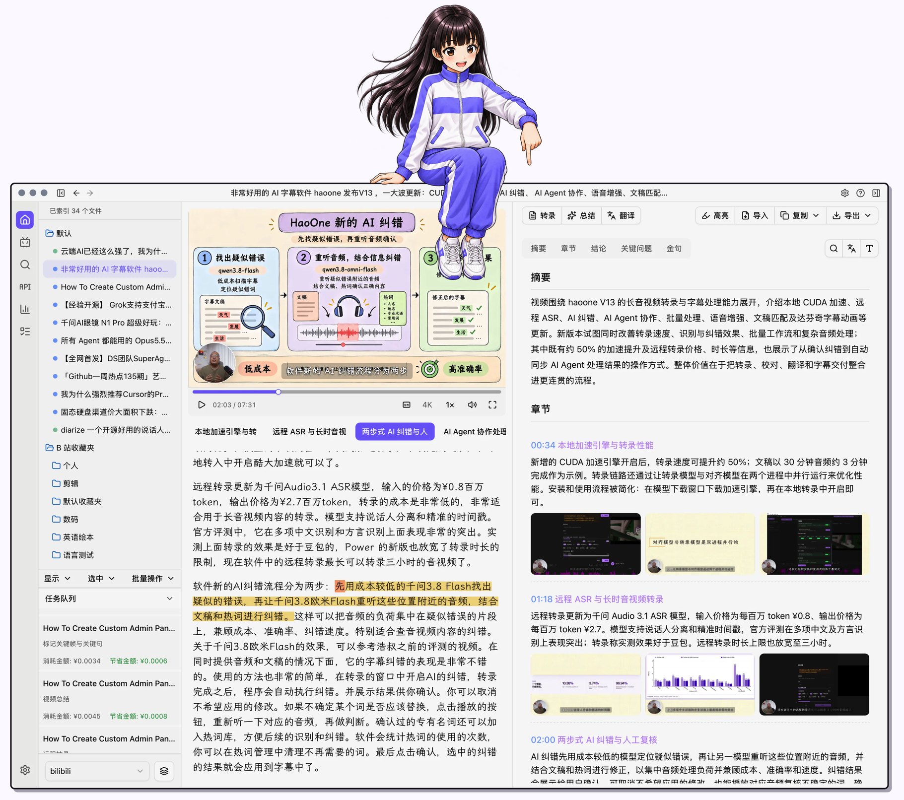
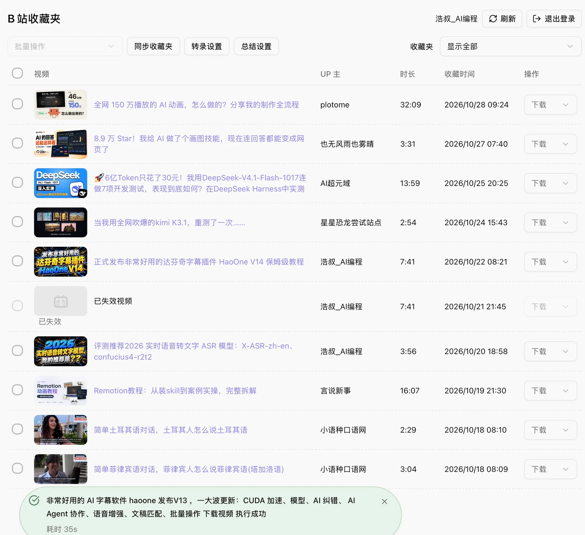
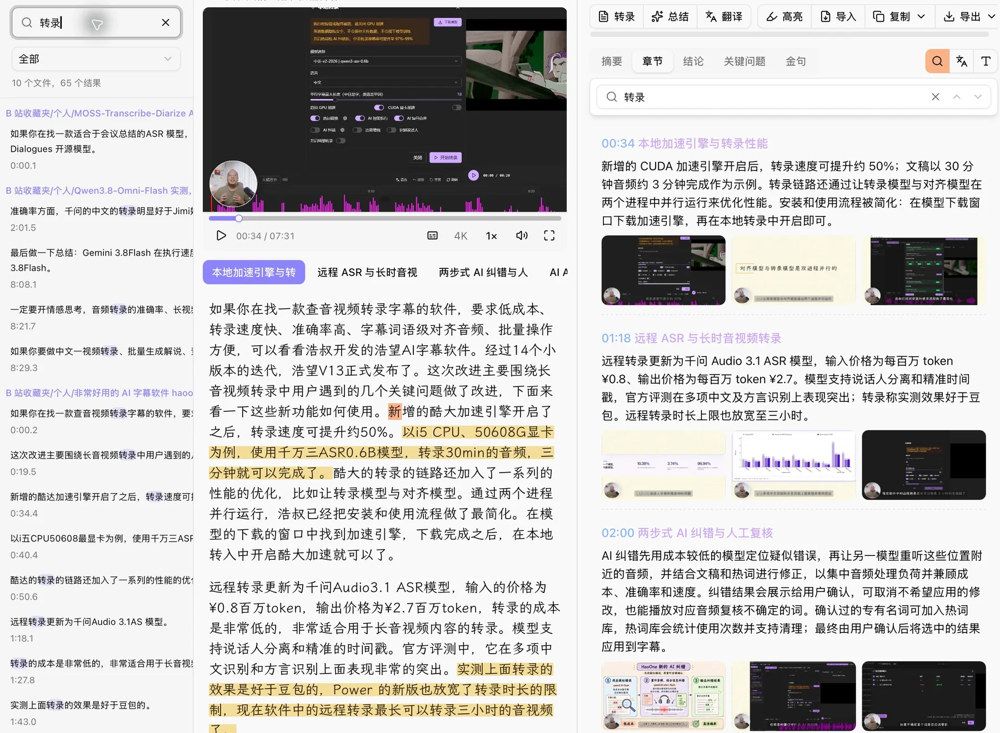
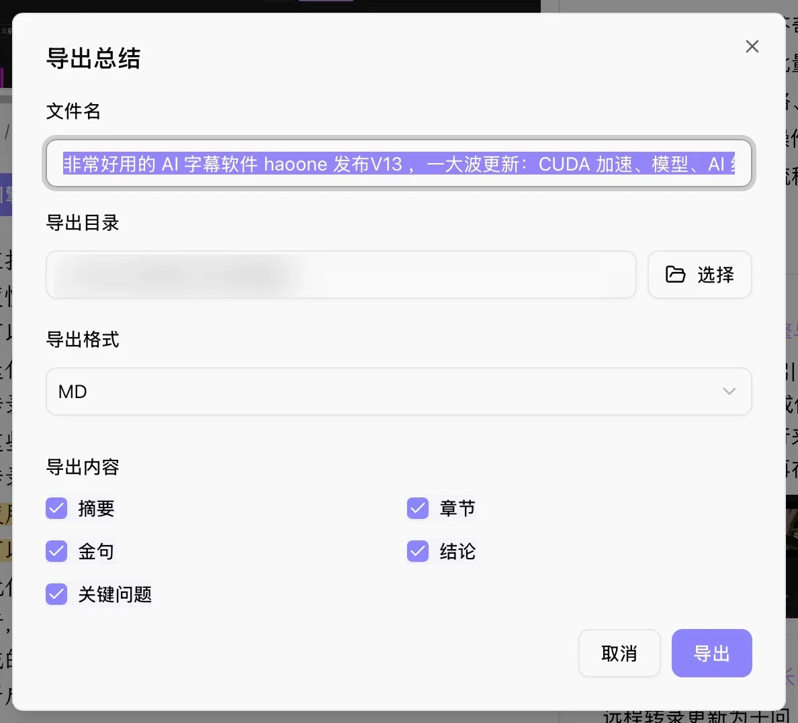

# OctSum 章鱼总结 APP

章鱼总结是一款AI视频总结、AI视频笔记软件，电脑端软件免费使用，支持 Windows 和 mac 开箱即用。

一键下载与总结B站视频，总结youtube视频，批量总结收藏夹视频。

使用超省钱 / 总结很到位 / 多端随时看 / 快搜快查视频知识库。

带有历时 1 年深度优化的本地模型执行引擎。

粘贴 B 站或 YouTube 视频链接，或导入本地音视频，就能把内容转成逐字稿，再生成带时间戳的总结、脑图等。

手机端开发中，后续可以实现在手机上浏览视频、总结，一键转录、总结、翻译。

  <a href="https://www.octsum.com">访问官网</a> ·
  <a href="https://github.com/minghe36/OctSum-app/releases/latest">下载安装包</a> ·
  <a href="./changelog/desktop">更新日志</a> ·
  <a href="https://www.bilibili.com/video/BV1tVWm6GEuG">视频教程</a> ·
  <a href="https://www.octsum.com/guide/">文字教程</a>

下载软件后，到[官网](https://www.octsum.com) 0 元领取下电脑端永久使用激活码，激活软件后即可全功能使用。

总结案例可以看[章鱼每日 youtube 精选](https://www.octsum.com/zh/daily-ai)。

## 主要功能

### 下载、转录与总结

- **一键下载、转录和总结**。粘贴 B 站或 YouTube 视频链接，在同一个任务里完成下载、生成逐字稿和总结。
- **同步视频收藏夹**。把 B 站、YouTube 和快手的收藏夹同步到章鱼总结，集中浏览并选择要处理的视频。
- **本地转录**。可选用客户端提供的所有本地转录模型，将音视频转成逐字稿，并可按需开启说话人识别。
- **远程转录**。可在客户端选择可用的在线转录模型。
- **一键 AI 总结**。把逐字稿整理成带时间戳的章节总结，方便浏览要点并跳回对应片段。
- **字幕翻译与双语字幕**。翻译视频字幕，对照查看原文和译文。

### 视频检索、整理与导出

- **本地向量数据库**。在本机建立视频内容的检索索引。
- **语义搜索视频片段**。可以用自然语言描述想找的内容，也可以描述画面来查找相关片段。
- **自动抽取关键帧**。从视频中提取代表性画面，方便浏览和定位内容。
- **高亮片段**。标记值得回看或剪出的片段，方便后续整理。
- **批量操作**。一次选择多个条目进行处理，减少逐个操作。
- **导出文档或视频片段**。把处理结果导出为文档，也可以单独导出选中的视频片段。

### 浏览器扩展与自动化

- **章鱼总结浏览器插件**。在 Chrome 或 Edge 中把正在浏览的视频发送到桌面应用处理。
- **命令行工具**。通过 `octsum` 提交下载、转录或总结任务，也可以读取已有任务结果。
- **章鱼总结 Skill**。让支持 Skill 的 AI 助手通过 CLI 提交任务和读取结果。[OctSum Skill 使用说明](./skills/octsum-skill/SKILL.md)

## 历时 1 年深度优化的本地模型执行引擎

0 配置高速下载本地模型（自建了下载节点）

Windows 带有 CUDA 显卡加速引擎，MAC Metal+并发优化，不是简单的套壳软件，可能市面上运行 qwen3-asr-1.7B 模型最快的软件

快：本地转录3分钟视频（使用qwen3-asr-1.7B-章鱼优化版模型），mac mini m4 16G 20 秒内完成，Windows 5060 显卡 32 秒

准：识别准确率 汉语 96%、英语 97%、日语 94%

齐：自研词语级对齐算法，词语音频对齐率98%

支持任意长度的音视频转录，目前测试最长视频是 4 小时，2 小时的文件mac 耗时仅需 6 分钟，Windows i5 5060显卡 仅需 10 分钟

支持 中文、英文、日语、韩语、葡萄牙语、西班牙语、阿拉伯语、意大利语、德语、法语、印地语、泰语、越南语、印尼语、俄语、菲律宾语、土耳其语

自带说话人识别，分割准确率 95%

## 使用场景

- **复习网课和教程**。把 B 站课程或 YouTube 教程转成章节笔记。复习时先看要点，再按时间戳回到讲解、例题或操作演示。
- **快速浏览长视频**。遇到一两个小时的讲座、直播回放或评测视频，先看章节总结，挑出和自己问题有关的部分，再跳到对应片段细看。
- **整理播客和访谈**。导入录音或视频，开启说话人识别。先从总结里找出值得记录的观点，再对照逐字稿和原音核对是谁说的、原话是什么。
- **回顾会议和培训**。把本地录音转成逐字稿，从章节总结里找到讨论过的决定和待办，再回听相关片段，确认负责人、时间等细节。
- **阅读外语视频**。先转录并翻译字幕，再结合章节总结浏览内容。碰到不熟悉的术语，可以跳回原视频，结合画面和上下文理解。

## 下载与使用

从 [GitHub Releases](https://github.com/minghe36/OctSum-app/releases/latest) 下载对应的桌面安装包。macOS Apple Silicon 选择 `.dmg`，Windows x64 选择 `-setup.exe`。

1. 打开章鱼总结，在首页粘贴视频链接，或导入本地音视频。
2. 选择总结，等待转录和总结完成。
3. 打开结果，查看章节总结、逐字稿和对应的视频片段。

本地转录需要先下载模型。使用在线 AI 功能时，费用以客户端显示为准。

## 浏览器扩展、CLI 与 Skill

在 Chrome 或 Edge 中，可以通过浏览器扩展把当前视频交给桌面应用处理。

需要批量或脚本操作时，可以在应用设置中安装 `octsum` CLI，通过命令行提交下载、转录和总结任务，或读取已有结果。

支持 Skill 的 AI 助手也可以通过 CLI 调用这些能力。[OctSum Skill 使用说明](./skills/octsum-skill/SKILL.md)
